<p align="center">
  
</p>

<p align="center">
  
</p>

<p align="center">
  <a href="https://neural-y.pages.dev"></a>
  <a href="https://bsky.app/profile/neural-y.bsky.social"></a>
  <a href="https://www.linkedin.com/company/neural-y/"></a>
  <a href="https://www.reddit.com/r/NEURALY/"></a>
</p>

---

<details open>
<summary><b>⚡ What is NEURAL Y</b> <i>(click to collapse)</i></summary>

NEURAL Y is an open developer community building **real, future-facing software** in the open: AI/ML, operating systems, graphics, compilers, HPC and developer tooling.

**Goal:** ship work that has measurable impact on global open source and computer science.

```cpp
class NeuralY {
public:
    Entry   entry   = "open to everyone";
    Metric  merit   = "merged PRs, shipped code, solved problems";
    Ignored ignored = {"degrees", "years of experience", "titles", "age"};

    void mission() {
        build(real_technology);
        publish(openly);
        scale(global_impact);
    }
};
```

</details>

---

<details open>
<summary><b>🧭 Principles</b> <i>(click to collapse)</i></summary>

| | |
|---|---|
| **Code speaks** | Your PR is your résumé. Background and experience are irrelevant here. |
| **Merit, in the open** | Decisions happen in issues and PRs, publicly and with reasons. |
| **Ship real things** | Working software, benchmarks and papers beat demos and slides. |
| **Future first** | We pick problems that matter 5–10 years out, not just today. |
| **Earn a seat** | Top contributors are invited to the maintainer team: they maintain projects and keep the community alive forever. |

</details>

---

<details open>
<summary><b>🌌 Focus Areas</b> <i>(click to collapse)</i></summary>

| Area | Scope |
|---|---|
| 🧠 **AI / ML** | Neural network diagnostics, LLMs, training and evaluation tooling |
| 🖥️ **Systems & OS** | Kernels, runtimes, low-level performance |
| 🎮 **Graphics** | Vulkan, OpenGL, real-time visualization |
| 📷 **Vision** | Computer vision research and pipelines |
| 🛠️ **Dev Tooling** | Compilers, languages, CSS/UI tooling |
| 🔬 **Research** | Open papers, reproducible results, shared benchmarks |

</details>

---

# 🤝 Contribute in 4 Steps

1. **Pick** an issue: [good first issues](https://github.com/search?q=org%3ANEURAL-Y+label%3A%22good+first+issue%22+state%3Aopen&type=issues) or propose your own.
2. **Fork, branch, build.** Keep PRs small and focused.
3. **Open a PR.** Explain the *why*, include tests or benchmarks.
4. **Iterate in review.** Merged work earns trust, and top contributors are invited to the maintainer team to maintain projects and keep the community alive forever.

No application, no CV, no gatekeeping. Just PRs.

---

# 🏆 Contributors

<p align="center">
  <a href="https://github.com/NEURAL-Y/NEURAL-Y/graphs/contributors">
    
  </a>
</p>

<p align="center"><i>Every face here got here through merged work.</i></p>

---

<details>
<summary><b>⚙️ Founder's Tech Stack</b> <i>(click to expand)</i></summary>

<p align="center">
  
</p>

</details>

---

<details>
<summary><b>📜 Certificate</b> <i>(click to expand)</i></summary>

<p align="center">
  
</p>

</details>

---

# 🧑‍💻 Stewardship

<table align="center">
<tr>
<td align="center" width="180">
  <a href="https://github.com/NEURAL-Y"></a><br>
  <b>Ayush Sharma</b><br>
  <sub>Founder · Leading Maintainers Team</sub>
</td>
<td>
  Started NEURAL Y and is Leading Maintainers: reviews PRs, works in public, and brings top contributors into the maintainer team.<br><br>
  <a href="https://www.linkedin.com/in/ayush-sharma-b08169355"></a>
  <a href="https://orcid.org/0009-0003-7950-5924"></a>
  <a href="https://x.com/Ayushsharm2uuz"></a>
  <a href="https://www.ssrn.com/ssrn/"></a>
</td>
</tr>
</table>

<p align="center"><i>The maintainer team is open to top contributors.</i></p>

---

> *"Intelligence emerges from connected systems."*
> *"Communities scale what individuals can't."*
> *"Every optimization begins with understanding."*


